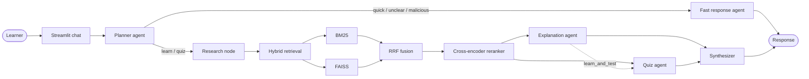

<div align="center">

# 🎓 AI Study Assistant

### Learn deeply. Practice intelligently. Remember longer.

An open-source, multi-agent study companion that turns your questions and PDFs into grounded explanations and personalized quizzes.

<p>
  <a href="#-quick-start">Quick start</a> ·
  <a href="#-what-it-does">What it does</a> ·
  <a href="#-how-it-works">How it works</a> ·
  <a href="#-configuration">Configuration</a> ·
  <a href="#-roadmap">Roadmap</a>
</p>

<p>
  
  
  
  
  
</p>

</div>

<br>

<table>
<tr>
<td width="33%" align="center">🧭<br><b>Intent-aware</b><br><sub>Routes every request to the right path</sub></td>
<td width="33%" align="center">📚<br><b>Grounded in your notes</b><br><sub>Hybrid retrieval for useful context</sub></td>
<td width="33%" align="center">⚡<br><b>Fast when it can be</b><br><sub>Lightweight responses for simple questions</sub></td>
</tr>
</table>

## ✨ What it does

AI Study Assistant is a Streamlit application built for the HCL Tech Hackathon. It combines a typed [LangGraph](https://langchain-ai.github.io/langgraph/) workflow with a hybrid retrieval pipeline, so the experience adapts to what a learner is actually asking for.

Ask it to:

- **Learn** a topic with a structured explanation.
- **Practice** with exactly three multiple-choice questions and answer explanations.
- **Learn and test** in one conversational turn.
- **Chat quickly** without paying the cost of the full retrieval path.
- **Study from a PDF** uploaded directly in the sidebar.

## 🧩 Why it is different

| Capability | How it helps |
| --- | --- |
| **Intent routing** | A planner classifies each request as `learn_and_test`, `learn_only`, `quiz_only`, `quick_question`, `unclear_intent`, or `malicious_intent`. |
| **Hybrid RAG** | FAISS semantic search and BM25 keyword search are combined with Reciprocal Rank Fusion. |
| **Cross-encoder reranking** | The strongest candidates are rescored for query-level relevance before reaching the LLM. |
| **Context positioning** | The top three chunks are reordered to reduce the lost-in-the-middle effect. |
| **Two-speed inference** | LLaMA 3.3 70B handles teaching and assessment; LLaMA 3.1 8B handles fast-path replies. |
| **Guardrails** | Prompt-injection and system-prompt extraction attempts are routed to a polite refusal path. |

## 🗺️ How it works



### Retrieval pipeline

```text
PDF upload
   ↓
PyPDFLoader → 500-token chunks with 50-token overlap
   ├── all-MiniLM-L6-v2 embeddings → FAISS (semantic recall)
   └── tokenized chunks → BM25 (keyword recall)
                         ↓
                  Reciprocal Rank Fusion
                         ↓
             ms-marco-MiniLM-L-4-v2 reranking
                         ↓
                    Top 3 context chunks
```

### Routing at a glance

| Request | Route | Result |
| --- | --- | --- |
| `Teach me photosynthesis` | Research → Explain → Quiz → Synthesize | Explanation + 3 MCQs |
| `Explain gravity, no quiz` | Research → Explain → Synthesize | Explanation |
| `Quiz me on DNA` | Research → Quiz → Synthesize | 3 MCQs |
| `Hi` | Fast response | Friendly greeting |
| Prompt-injection attempt | Fast response | Polite refusal |

## 🚀 Quick start

### 1. Clone and enter the project

```bash
git clone <your-repository-url>
cd multi-agent-study-assistant
```

### 2. Create an environment

```bash
python -m venv .venv

# Windows PowerShell
.venv\Scripts\Activate.ps1

# macOS / Linux
source .venv/bin/activate
```

### 3. Install dependencies

```bash
python -m pip install --upgrade pip
pip install -r requirements.txt
```

### 4. Add your Groq key

Create a `.env` file beside `app.py`:

```env
GROQ_API_KEY=gsk_your_actual_key_here
```

Create a free key at [console.groq.com/keys](https://console.groq.com/keys). Keep `.env` local; it is ignored by Git.

### 5. Launch

```bash
streamlit run app.py
```

Open [http://localhost:8501](http://localhost:8501).

> **First run:** the embedding model (~90 MB) and cross-encoder (~70 MB) are downloaded from Hugging Face and cached locally. Later runs reuse the cache.

## 🎯 Usage

### General knowledge mode

You can start chatting immediately:

```text
Teach me about the water cycle and then test me
```

```text
Only explain Newton's first law
```

```text
Quiz me on the causes of the French Revolution
```

### PDF study mode

1. Open the **Study Materials** panel.
2. Upload a text-based PDF.
3. Wait for **Document loaded ✓**.
4. Ask questions about the material.
5. Select **Clear Memory & Start Over** when you want a fresh session.

The uploaded document is held in the current Streamlit session. It is not stored in the repository.

## 🧱 Project structure

```text
.
├── app.py                         # Streamlit UI and session state
├── agents/
│   ├── planner_agent.py           # Intent classification and guardrails
│   ├── explanation_agent.py       # Teaching responses
│   ├── quiz_agent.py              # Three-question MCQ generation
│   ├── fast_response_agent.py     # Low-latency conversational path
│   └── groq_llms.py               # Groq model configuration
├── graph/
│   └── study_graph.py             # Typed LangGraph workflow
├── memory/
│   ├── vector_store.py            # PDF loading, chunking, and FAISS
│   ├── bm25_store.py              # Sparse keyword retrieval
│   ├── retriever.py               # Fusion, reranking, and reordering
│   └── sample_notes/              # Small local notes for smoke tests
├── scripts/
│   └── verify_components.py       # Component and optional live checks
├── requirements.txt
└── readme.md
```

## ⚙️ Configuration

| Variable | Required | Description |
| --- | :---: | --- |
| `GROQ_API_KEY` | Yes | API key used by the planner, tutor, quiz, and fast-response agents |

The active model roles are:

| Model | Role |
| --- | --- |
| `llama-3.3-70b-versatile` | Intent classification, explanations, and MCQ generation |
| `llama-3.1-8b-instant` | Greetings and simple fast-path responses |

If the key is missing or invalid, the app displays a setup message in the UI rather than silently failing.

## ✅ Verify the components

Run the local smoke checks from the project root:

```bash
python scripts/verify_components.py
```

The script checks document loading, chunking, FAISS, BM25, cross-encoder reranking, and LangGraph compilation. End-to-end Groq checks run only when a valid key is available.

## 🛠️ Troubleshooting

| Symptom | Fix |
| --- | --- |
| `AuthenticationError (401)` | Create a fresh key at [Groq Console](https://console.groq.com/keys), then update `.env`. |
| `GROQ_API_KEY` missing | Put `.env` in the same directory as `app.py`; use `GROQ_API_KEY=...` with no extra spaces. |
| Slow first launch | Wait for the Hugging Face models to download once. |
| PDF cannot be read | Use a valid, non-encrypted, text-based PDF. |
| Dependency import errors | Activate `.venv` and run `pip install -r requirements.txt` again. |

## 🧪 Design notes

- **No PDF is also valid:** without an upload, the agents use general model knowledge.
- **The graph is stateful:** each node receives and returns typed `AgentState` fields.
- **Retrieval is two-stage:** broad recall comes first; precise reranking happens second.
- **The UI is session-scoped:** clearing memory removes the active indexes and chat history.

## 🗺️ Roadmap

- [ ] Add persistent, user-selectable study collections.
- [ ] Add source citations for retrieved PDF chunks.
- [ ] Add progress tracking across quiz sessions.
- [ ] Add automated tests for routing and retrieval edge cases.
- [ ] Add deployment instructions for Streamlit Community Cloud.

## 🤝 Contributing

Ideas, bug reports, and pull requests are welcome. A good contribution usually follows this flow:

1. Open an issue describing the learner experience or bug.
2. Create a focused branch.
3. Make the smallest coherent change.
4. Run `python scripts/verify_components.py`.
5. Open a pull request with a concise explanation and screenshots for UI changes.

## 📄 License

Released under the [MIT License](https://opensource.org/license/mit/).

## 🙏 Acknowledgements

Built with:

- [LangChain](https://github.com/langchain-ai/langchain) and [LangGraph](https://github.com/langchain-ai/langgraph)
- [Groq](https://groq.com) and LLaMA models
- [Streamlit](https://streamlit.io)
- [FAISS](https://github.com/facebookresearch/faiss)
- [Sentence Transformers](https://www.sbert.net/)
- [rank-bm25](https://github.com/dorianbrown/rank_bm25)

<div align="center">

<br>

**Built for curious minds and the HCL Tech Hackathon 🚀**

If this project helps you learn, consider giving it a ⭐ on GitHub.

</div>
